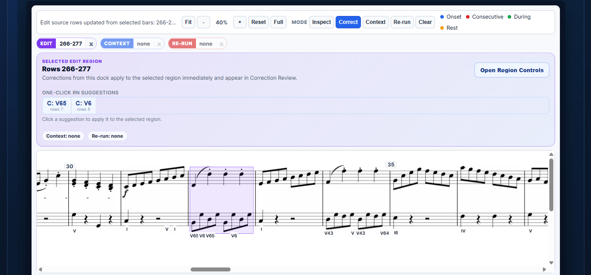

Suppose you’re annotating the harmony of a score. An automatic analysis gives you Roman numerals for the whole piece, but one bar deserves a second look. The model changes its label several times as the notes move. You hear the bar as a single harmony. The next bar is less obvious, and how you read it depends partly on the decision you make here. Can you correct the first bar, keep that interpretation fixed, and ask the model to reconsider what comes next?

I kept coming back to this kind of interaction while working on automatic music analysis. A full set of labels is a useful starting point, especially when you have a corpus to annotate. But much of the work happens once those labels are on the page. You check where a harmony starts and ends, compare readings of an ambiguous passage, and revisit an earlier decision when a cadence clarifies the local key. Every one of those actions is familiar to an analyst. A model that predicts an entire score in one pass gives you little control over what happens between one prediction and the next.

That’s the question behind our ISMIR 2026 paper, *From Prediction to Collaboration: Interactive Symbolic Music Analysis*. We developed a system that can make a first-pass analysis, use annotations you already trust, and revisit the places you select. I’ll walk through that loop using the public interface. You can follow along with the score that’s already loaded. [Open the AnalysisGNN web demo.](https://analysisgnn.com/)

## Inspect the analysis on the score

The demo starts with a precomputed analysis, so the notation and predictions are available immediately. Roman numerals appear below the lowest staff at harmonic changes. A Roman numeral describes a chord relative to a key, which is why a disagreement about the local key can change the reading even when two analysts agree on the notes that make up the chord.

The bundled score is the easiest way to try the editing loop. To work with another piece, upload a symbolic score in MusicXML, compressed MusicXML, MEI, or Humdrum kern format, or provide a direct public link to the file. Run inference to get the first analysis, then switch to the score view. For a corpus project, I’d start with a piece I already know well. It’s easier to tell which suggestions help when you have a few passages in mind where you expect the analysis to be tricky.

In **Inspect** mode, click a note. The score highlights the active Roman-numeral span, and the analysis panel shows the current label and alternatives. It also shows related predictions, including local key, cadences, and phrase boundaries. I like to start here because the first thing I want to see is what the model has grouped together. A plausible chord label can still be attached to a span that begins too early or ends too late.

The distinction between a note and a span matters in the paper as well. Our model makes predictions at the note level. An analyst might want to inspect one note, the notes that begin together at an onset, a beat, or a measure. In the paper prototype, we combine the predictions at those different scales and surface candidate Roman numerals for each. That makes it possible to look at the overall reading of a bar and then zoom in on the moment where the model starts to disagree with itself. The prediction table is there when you want to inspect the underlying rows and confidence values. For reviewing a passage, I usually start with the notation. [AnalysisGNN walkthrough](https://analysisgnn.com/tutorial)

## Make a correction at the musical scale

The screenshot below shows a selected bar in **Correct** mode. Under the notes, the analysis alternates between `V65` and `V6`. The interface offers both readings above the score. If you judge that one harmony holds through the bar, you can select the whole bar and apply your reading once. The alternatives help you see what the model was considering, and you can choose the label that best fits your reading of the passage.

The region controls also let you change the local key or correct a cadence. Sometimes the edit is simpler. If the model has introduced a new Roman numeral where you hear the previous harmony continuing, **Clear Label** removes that change so the passage inherits the preceding label. What matters is that you can make the edit at the scale of the musical decision. A reading that applies to a whole passage should take one correction, even if the model represents it across many note rows.

You can see the edit in **Correction Review** and undo it if you change your mind. At this point you can keep annotating manually, and your correction already belongs to the analysis. A new model run is optional. That separation is important because sometimes I already know what I want to change and have no reason to revisit the surrounding music. [Editing controls in the walkthrough](https://analysisgnn.com/tutorial)

## Let the model work from your edits

Now return to the less obvious bar that follows. Mark the corrected passage as **Context**, select the following passage as the **Re-run** target, and run the selected region. The model uses the fixed labels as evidence and revisits the target. The review panel shows the rows that supplied context, the rows that were reconsidered, and whether any labels changed. A rerun may return the same analysis. Either way, you have something specific to review alongside the score.

I think of this as the point where prediction becomes collaboration. The model’s first pass gives me something to react to. Once I decide how to read part of the score, I can put that decision back into the process and control where the model makes another proposal. The scope is as important as the correction. I might want to revisit the approach to a cadence while keeping the cadence itself fixed, or fill a gap between two sections whose harmonies I’ve already annotated.

Repetition gives rise to a slightly different task. If an edited figure comes back later, I may want to see where else the same correction could apply. The interface can look for passages with a similar rhythmic shape, interval contour, and harmonic context. It offers a candidate for review and applies the correction when you accept it. A repeated passage that moves into a different harmonic context is a good reason to inspect the match or ask for a fresh prediction. [Selective reruns and similar passages in the walkthrough](https://analysisgnn.com/tutorial)

## What it took to make the model editable

I came to this question through two earlier projects. In [ChordGNN](https://arxiv.org/abs/2307.03544), we represented a score as a graph of notes and used that structure to predict Roman numerals at onsets. In the earlier [AnalysisGNN paper](https://arxiv.org/abs/2509.06654), we moved from harmonic analysis toward joint predictions of harmony and structure. This included tasks such as cadence and phrase-boundary detection, even when the available training corpora annotated different aspects of the music.

### Encode the score once

The model in the ISMIR paper, **RNHybrid**, reads the same score in two ways. On the sequence side, we tokenize the score using a REMI-style vocabulary and run it through a frozen MusicBERT encoder. We use a token-to-note map to pool the contextual vectors back onto the notes. On the graph side, we concatenate those vectors with features such as pitch spelling and key signature. The graph connects notes that start together, follow one another, overlap, or are separated by rests. It also includes beat and measure nodes to represent the hierarchy of the score. A note can therefore receive information from a sustained voice it overlaps as well as from notes that start at the same time. [RNHybrid architecture](https://arxiv.org/html/2607.13587v1#S3.SS2)

After message passing, separate classification heads predict 20 analytical properties. Some describe the harmony, such as local key, scale degree, chord quality, and inversion. Others describe the role of a note or the structure of a passage, such as whether a note belongs to the chord or whether a cadence occurs. This is where the earlier AnalysisGNN work carries through. The model has a shared representation of the passage and several ways to describe what’s happening in it.

For me, the split between the sequence encoder and the graph also solves a practical problem. Changing `V6` to `V65` changes an annotation and leaves the score tokens intact. We can cache the expensive MusicBERT vectors and rerun the conditioned graph model with the updated labels. That lets us reuse the score representation across a series of small corrections. [Architecture and inference details](https://arxiv.org/html/2607.13587v1#S3)

### Put the analyst’s labels into the graph

The first-pass checkpoint predicts from the score alone. We use it as the teacher for a second checkpoint that learns to complete partial analyses. For the tasks that support conditioning, we turn each supplied label into a learned vector and add that information at the corresponding note before message passing. Unknown labels get a mask embedding. This gives a correction two jobs. It supplies evidence that can travel through the graph, and it stays fixed in the output through an explicit constraint at inference time. For example, if I fix the local key in the context region, the model can use that decision when it predicts the harmony in the target passage.

During training, we mask both scattered notes and spans of onsets. The first pattern teaches the model to fill isolated holes, and the second gives it practice with contiguous gaps such as an unfinished phrase. The completion loss focuses on the hidden labels. We also mix in unmasked batches and use distillation losses from the first-pass teacher to preserve behavior on tasks and notes outside the edit. That’s the training counterpart to **Context** and **Re-run** in the interface. The analyst supplies the labels they trust and chooses where to ask for new predictions. [Masked conditioning and training](https://arxiv.org/html/2607.13587v1#S3.SS3)

### Turn note probabilities into something you can edit

The graph predicts at note level, but a chord label may apply to a beat or an entire bar. We aggregate component probabilities over the selected scope and show the top Roman-numeral candidates at the note, onset, beat, or measure level. In the paper prototype, choosing a candidate also shows which component predictions agree with that reading. If the key and scale degree agree but the inversion is uncertain, I can see which part of the analysis deserves a closer look. That connects the internals of the model to the decision I actually make on the score. [Candidate inspection in the paper](https://arxiv.org/html/2607.13587v1#S6)

## What we measured

We evaluated the two checkpoints separately on Dilemmadata, using held-out test subsets from AugmentedNet and the Distant Listening Corpus. In the full-score setting, RNHybrid had no labels to start from. On the Distant Listening subset it scored **57.8%** on the Roman-numeral measure, compared with **51.6%** for the earlier AnalysisGNN. The measure requires the local key, degree, chord quality, and inversion to agree with the reference. That gives us a sense of how useful the initial predictions can be before anyone starts editing.

For completion, we supplied a fraction of the reference annotations as context and scored only the positions we had hidden. On the Distant Listening subset, accuracy on those positions rose from **57.3%** with 5% of labels supplied to **80.1%** with 95% supplied. The AugmentedNet subset showed the same upward trend. In both cases, the question was how well the model could fill gaps as more of the surrounding analysis became known. [Results and evaluation protocol](https://arxiv.org/html/2607.13587v1#S4)

Those experiments used sampled masks. A person working through a real score might fix all the cadences first, work section by section, or return to the handful of passages where the harmony is genuinely debatable. I’d like to know which of those strategies the model supports best, how often a rerun helps, and where the interaction adds more work than it saves. Those are questions for a study with analysts working on real annotation tasks. The demo gives us a place to observe that process. [Discussion and future work](https://arxiv.org/html/2607.13587v1#S6)

There’s a musical reason I care about that distinction. Two analysts can agree about the chords in a passage and still place a modulation at different points. That difference can be interesting to the people using the corpus. A benchmark can tell us how often the system agrees with one reference annotation. The workflow also has to let an analyst inspect alternatives, choose a reading, and make sure that reading survives the next prediction. [Discussion in the ISMIR paper](https://arxiv.org/html/2607.13587v1#S6)

## Take the annotation with you

The export is part of the workflow. You can download the corrected analysis as annotated MusicXML to continue working in a notation editor, a DCML harmonies TSV for corpus work, or a CSV to inspect the rows in a spreadsheet. The exports use the corrected analysis, so an edit you made in the score view travels with the file. This matters if you’re assembling a corpus over several sessions or handing an analysis to someone else for review. [Export options in the walkthrough](https://analysisgnn.com/tutorial)

If you try the demo, start with one bar you would read differently. Correct it, keep it fixed, and give the model a nearby passage to reconsider. Then take a look at the exported score. That small experiment takes you through the decisions I wanted this project to support, from inspecting the model’s reading of the score to deciding what goes into your own annotation.

[Try the demo](https://analysisgnn.com/) · [Read the paper](https://arxiv.org/abs/2607.13587) · [See the ISMIR poster and talk](https://ismir2026program.ismir.net/poster_342.html#details) · [Browse the code](https://github.com/manoskary/analysisgnn)

The ISMIR 2026 paper is joint work with Johannes Hentschel, Markus Neuwirth, and Gerhard Widmer.
